# Manual test: mermaid diagram types

Run from the repo root, in a real terminal (not the desktop app):

```
cd tools && npm install && npm run build:vendor && cd ..
claude --plugin-dir .
```

Then paste this prompt:

> Reply with exactly these mermaid code blocks, one per diagram type, each in its own
> ```mermaid fence, with a one-line label above each. Do not change the diagram text.

followed by the diagrams below. Or paste each diagram yourself in a fence.

Expected: every block is drawn as text with a `show source` line above it, except the
"must stay code" ones.

## Should be drawn (existing types, check for regressions)

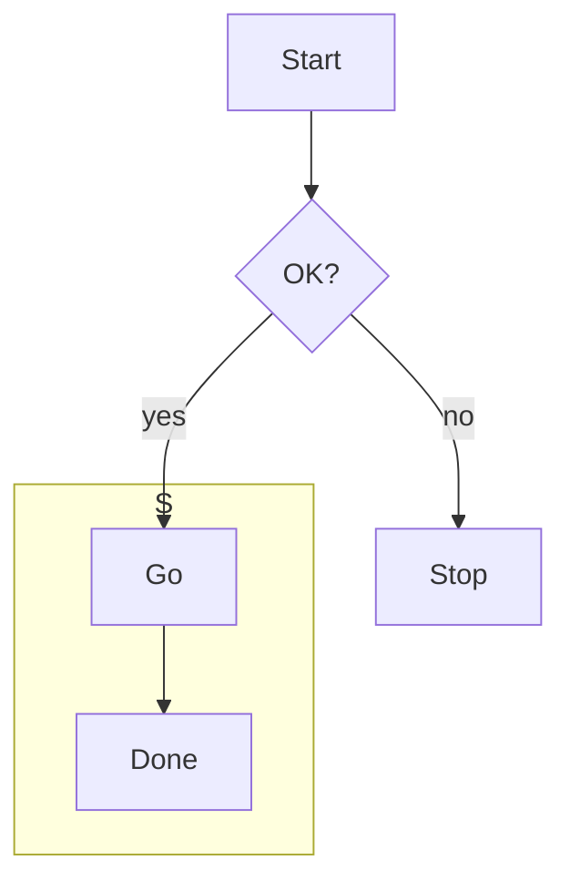

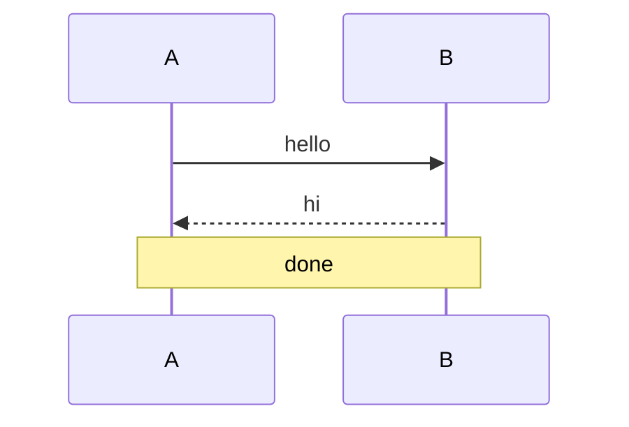


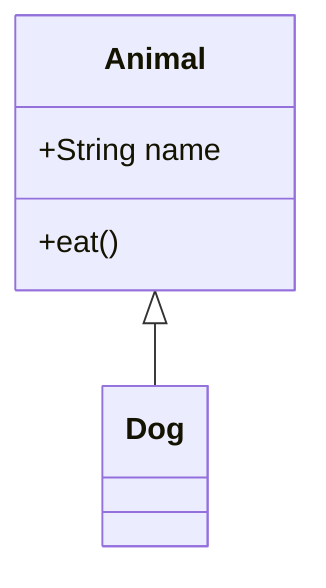

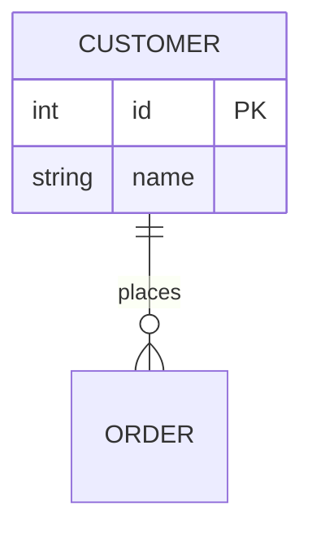

## Should be drawn (new types)

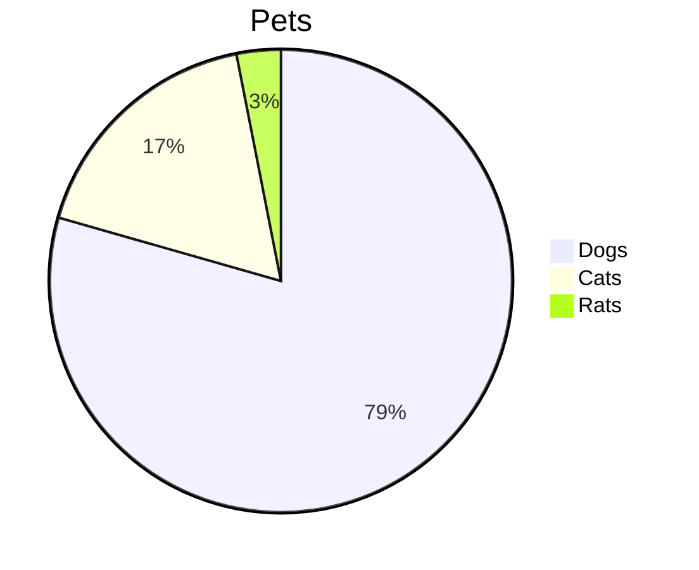

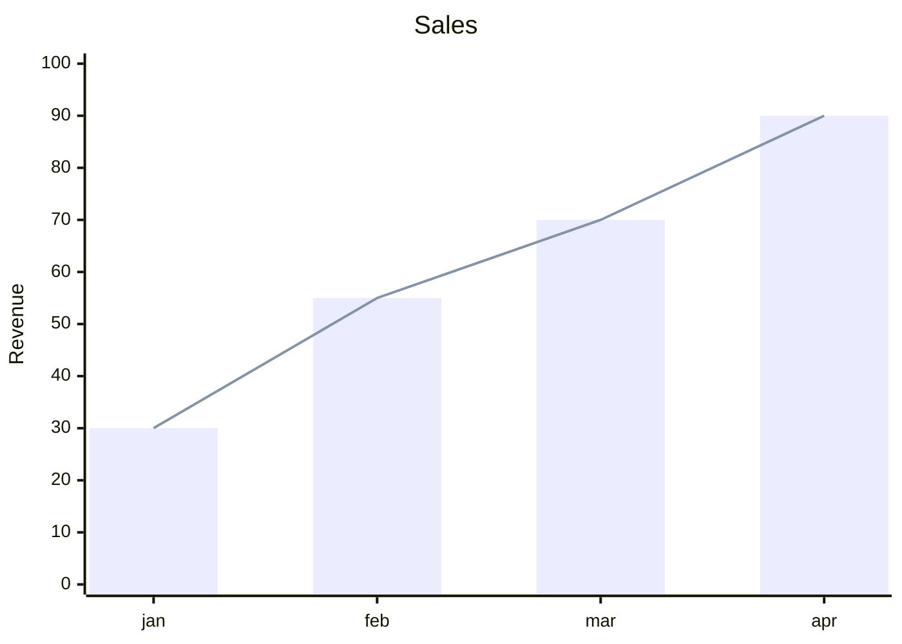

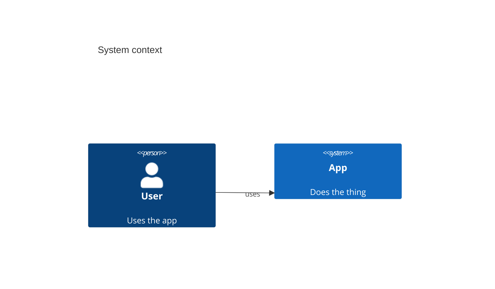

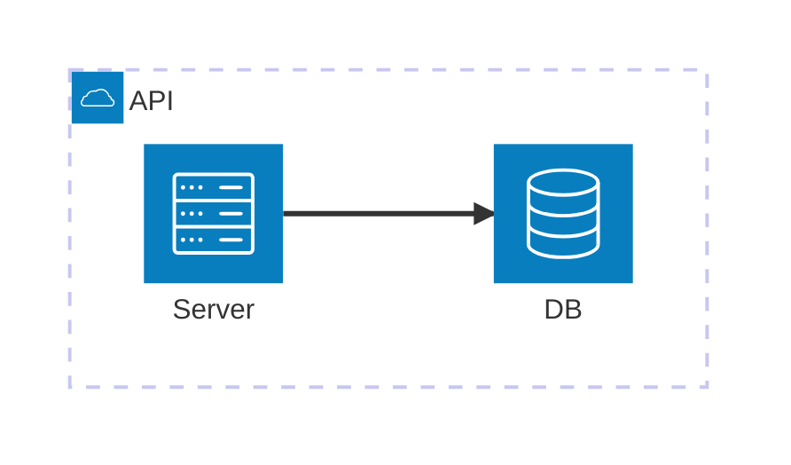

## Must stay code (no renderer)

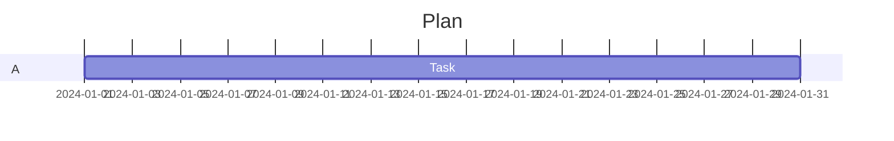

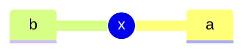

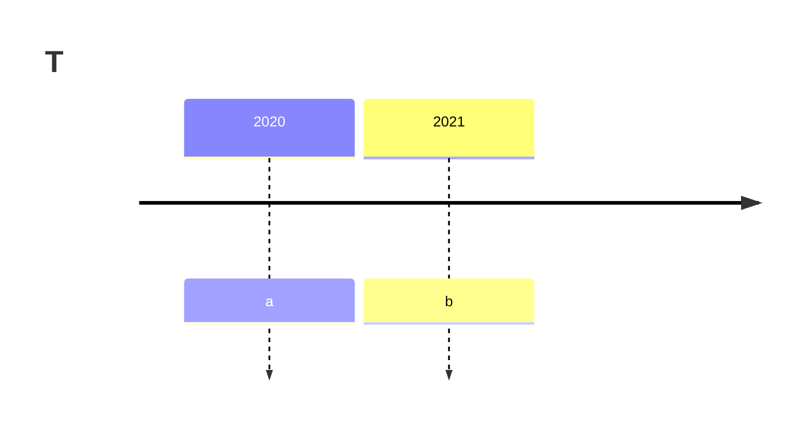

## Checklist

1. Each "should be drawn" block shows a text diagram and a `show source` line; pressing
   it shows the code, `show diagram` goes back.
2. The three "must stay code" blocks look exactly like stock Claude Code code blocks.
3. Narrow the terminal to about 60 columns: the pie and XY chart (about 65 wide) fall
   back to code instead of wrapping badly; widen it and they draw again.
4. `/rich-ui`, turn Mermaid off: every block goes back to code; on again: they redraw.
5. Light and dark themes: the lines are readable in both.
6. Regression eye-check against the old renderer: state diagram (the start marker is
   known to be missing), ER and class diagrams look sensible.
7. Malformed input stays code and does not crash the reply, e.g. a `pie` fence with no
   rows, or an `xychart-beta` with `bar [` unclosed.
